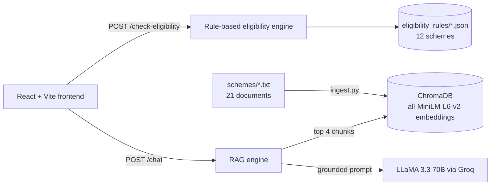

# KisaanSathi

**A farmer-first platform that tells you which government schemes you actually qualify for, not just what exists.**

Indian farmers can apply for dozens of central and Maharashtra state schemes, but finding out which ones apply to *them* means reading long official documents full of exclusions and conditions. KisaanSathi does two things:

1. **Checks eligibility** for 12 schemes from a short form, and explains *why* the farmer qualifies or doesn't, with the benefit and the documents to bring.
2. **Answers questions** in plain language ("How do I claim crop insurance after a drought?") using retrieval-augmented generation over 21 scheme and guidance documents, and shows the sources it used.

## How it works



### Eligibility is rule-based on purpose

Whether a farmer qualifies for a government scheme should be a **traceable yes/no decision, not a probabilistic guess**. So the eligibility engine doesn't use the LLM at all. Each scheme's conditions live in a JSON rule file (land-holding caps, age limits, farmer type, state residency, required enrolments such as PM-KISAN or a Kisan Credit Card, and exclusions such as income-tax payers or government employees). `eligibility_engine.py` checks a farmer's profile against every file and returns, per scheme:

- eligible or not,
- the exact reasons for any rejection (e.g. *"Land holding 3.0 ha exceeds the 2.0 ha cap"*),
- the benefit summary and the required documents.

### The chat is grounded in real documents

- `ingest.py` splits every document in `schemes/` into ~500-character chunks with 100 characters of overlap, breaking at paragraph boundaries, and stores their embeddings (sentence-transformers `all-MiniLM-L6-v2`) in a local ChromaDB collection.
- For each question, `rag_engine.py` retrieves the 4 most relevant chunks and asks LLaMA 3.3 70B (through Groq's OpenAI-compatible API) to answer **only from that context**. If the answer isn't there, the assistant says so and points the farmer to their nearest Krishi Vigyan Kendra or helpline instead of guessing.
- Every answer comes back with the source files it was based on.

## Schemes covered

| Central | Maharashtra |
|---|---|
| PM-KISAN Samman Nidhi | Namo Shetkari Maha Sanman Nidhi |
| PM Kisan Maandhan Yojana | Punyashlok Ahilyadevi Holkar Karjmafi Yojana |
| Pradhan Mantri Fasal Bima Yojana (PMFBY) | Gopinath Munde Shetkari Apghat Suraksha Sanugrah Anudan Yojana |
| Kisan Credit Card (KCC) | |
| Modified Interest Subvention Scheme (MISS) | |
| PMKSY Micro-Irrigation | |
| Paramparagat Krishi Vikas Yojana (PKVY) | |
| Sub-Mission on Agricultural Mechanization (SMAM) | |
| Soil Health Card Scheme | |

The chat's knowledge base also includes guidance on drought relief, loan restructuring, MSP prices, crop and district risk profiles, document checklists, helpline numbers and where to go for help.

## Tech stack

| Layer | Tools |
|---|---|
| Frontend | React 19, Vite, hash-based routing (no router dependency) |
| Backend | Python, FastAPI, Pydantic, Uvicorn |
| Retrieval | ChromaDB (persistent, local), sentence-transformers `all-MiniLM-L6-v2` |
| Generation | LLaMA 3.3 70B Versatile via the Groq API |

## API

| Method | Endpoint | Purpose |
|---|---|---|
| `GET` | `/` | Health check (the frontend header shows whether the backend is reachable) |
| `POST` | `/check-eligibility` | Body: a `FarmerProfile`. Returns `eligible_count`, `total_schemes_checked` and per-scheme `results` |
| `POST` | `/chat` | Body: `{ "question": "..." }`. Returns `{ "answer": "...", "sources": [...] }` |

## Run it locally

**Requirements:** Python 3.10+, Node.js 20+, and a free [Groq API key](https://console.groq.com/keys).

### 1. Backend

```bash
cd Backend
python -m venv venv
source venv/bin/activate        # Windows: venv\Scripts\activate
pip install -r requirements.txt
echo "GROQ_API_KEY=your_key_here" > .env
python ingest.py                # builds the vector store in Backend/chroma_db (first run downloads the embedding model)
uvicorn app:app --reload        # http://localhost:8000
```

Re-run `python ingest.py` whenever you add or edit a file in `schemes/`. `python inspect_db.py` lets you look inside the vector store.

### 2. Frontend

```bash
cd Frontend
npm install
cp .env.example .env            # VITE_API_URL=http://localhost:8000
npm run dev                     # http://localhost:5173
```

## Project structure

```
Backend/
  app.py                 FastAPI app and routes
  farmer_profile.py      Pydantic model of the intake form
  eligibility_engine.py  Deterministic rule matching with reasons
  eligibility_rules/     One JSON rule file per scheme (12)
  rag_engine.py          Retrieval + grounded answer generation
  ingest.py              Chunk, embed and store documents in ChromaDB
  inspect_db.py          Inspect the vector store
  schemes/               Source documents for the chat (21)
Frontend/
  src/components/        Home, 4-step EligibilityForm, EligibilityResults, Chat
  src/api.js             Client for the FastAPI backend
```

## Adding a scheme

1. Add the scheme's document to `Backend/schemes/` and run `python ingest.py`.
2. Add a rule file to `Backend/eligibility_rules/` with `scheme_id`, `name`, `level`, `benefit_summary`, `eligibility`, `exclusions` and `required_documents`. Exclusion keys map to `FarmerProfile` fields through `EXCLUSION_FIELD_MAP` in `eligibility_engine.py`.

## Disclaimer

Scheme rules change. KisaanSathi is a guide, not an official eligibility decision; always confirm with the official scheme portal, your Talathi or Gram Sevak, or the nearest Krishi Vigyan Kendra before applying.

## Author

**Prathmesh Bhilegaonkar**, B.Tech Computer Science Engineering, MIT ADT University, Pune
[GitHub](https://github.com/Prathmesh2492004) · [LinkedIn](https://www.linkedin.com/in/prathmesh-bhilegaonkar-297ba9233/)
